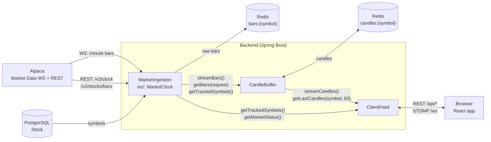

# OMAN Finance backend module diagram

## 1. Module view

Arrows show the direction data flows.

## 2. Component view

Arrows in this view show the direction data flows. The red path is a live
bar from Alpaca becoming a candle and reaching the browser. Dashed hexagons are
the public interfaces of each module.

```mermaid
%%{init: {
  "theme": "base",
  "themeVariables": {
    "fontFamily": "Inter, Segoe UI, Helvetica, Arial, sans-serif",
    "fontSize": "14px",
    "darkMode": true,
    "background": "#161616",
    "lineColor": "#a3a3a3",
    "textColor": "#e5e5e5",
    "primaryTextColor": "#e5e5e5",
    "clusterBkg": "#161616",
    "clusterBorder": "#525252",
    "edgeLabelBackground": "transparent"
  },
  "themeCSS": ".labelBkg, .edgeLabel, .edgeLabel p, .edgeLabel rect { background-color: transparent !important; fill: transparent !important; }",
  "flowchart": { "curve": "basis", "nodeSpacing": 45, "rankSpacing": 70, "padding": 18, "htmlLabels": true }
}}%%
flowchart TB
    subgraph ext[" "]
        direction LR
        alpaca["<b>Alpaca</b>"]
        pg[("<b>PostgreSQL</b><br/><small>Stock</small>")]
    end


    subgraph ingestion["<b>marketingestion</b>"]
        direction LR
        barsClient["<b>AlpacaBarsClient</b><br/><small>GET /v2/stocks/bars<br/>passes the request through, adds feed=iex,<br/>saves and returns the raw response</small>"]
        barRepo["<b>BarRedisRepository</b><br/><small>raw Alpaca bars</small>"]
        stockRepo["<b>StockRepository</b><br/><small>SELECT / INSERT / DELETE on Stock<br/>keeps the symbol list in memory</small>"]
        barsRequest["<i>«record»</i><br/><b>BarsRequest</b><br/><small>query of GET /v2/stocks/bars · free plan</small><small><table style='white-space:nowrap'><tr><td align='left'><b>symbols</b></td><td align='left'>AAPL,MSFT</td><td align='left'><i>required</i></td></tr><tr><td align='left'><b>timeframe</b></td><td align='left'>1Min</td><td align='left'><i>required</i></td></tr><tr><td align='left'><b>start</b></td><td align='left'>RFC-3339</td><td align='left'><i>start of day</i></td></tr><tr><td align='left'><b>end</b></td><td align='left'>RFC-3339</td><td align='left'><i>now</i></td></tr><tr><td align='left'><b>limit</b></td><td align='left'>1 – 10000</td><td align='left'><i>1000</i></td></tr><tr><td align='left'><b>sort</b></td><td align='left'>asc | desc</td><td align='left'><i>asc</i></td></tr><tr><td align='left'><b>adjustment</b></td><td align='left'>raw | split | dividend | spin-off | all</td><td align='left'><i>raw</i></td></tr><tr><td align='left'><b>asof</b></td><td align='left'>YYYY-MM-DD</td><td align='left'><i>today</i></td></tr><tr><td align='left'><b>currency</b></td><td align='left'>ISO 4217</td><td align='left'><i>USD</i></td></tr><tr><td align='left'><b>page_token</b></td><td align='left'>next_page_token</td><td align='left'><i>—</i></td></tr></table></small>"]
        barHub["<b>LiveBarStream</b><br/><small>emits each Bar to every subscriber<br/>no saving</small>"]
        streamClient["<b>AlpacaStreamClient</b><br/><small>WS connect, auth, subscribe,<br/>unsubscribe, reconnect<br/>JSON → Bar, no changes</small>"]
        ingestionApi{{"<i>«interface»</i><br/><b>MarketIngestion</b><br/><small>streamBars(): Stream#lt;Bar#gt;<br/>getBars(BarsRequest): BarsResponse<br/>getMarketStatus(): Clock<br/>getTrackedSymbols()<br/>addSymbol(symbol)<br/>removeSymbol(symbol)</small>"}}
        clock["<b>MarketClock</b><br/><small>polls /v2/clock at next open / close<br/>holds the last response in memory</small>"]
    end


    subgraph buffer["<b>candlebuffer</b>"]
        direction LR
        bufferApi{{"<i>«interface»</i><br/><b>CandleBuffer</b><br/><small>streamCandles(): Stream#lt;Candle#gt;<br/>getLastCandles(symbol, n)</small>"}}
        backfiller["<b>CandleBackfiller</b><br/><small>on startup and on gap:<br/>builds BarsRequest for the<br/>missing range (start, end, limit, sort)<br/>Bar → Candle</small>"]
        candleRepo["<b>CandleRedisRepository</b><br/><small>ZADD, ZREMRANGEBYRANK, ZRANGE<br/>on read: are all last 60 candles there?</small>"]
        recorder["<b>CandleRecorder</b><br/><small>consumes streamBars()<br/>Bar → Candle, detects gaps</small>"]
        candleHub["<b>LiveCandleStream</b><br/><small>1. save Candle to Redis<br/>2. emit to every subscriber</small>"]
    end

    subgraph feed["<b>clientfeed</b>"]
        direction LR
        wsConfig["<b>WebSocketConfig</b><br/><small>STOMP endpoint /ws</small>"]
        broadcaster["<b>CandleBroadcaster</b><br/><small>consumes streamCandles()</small>"]
        rest["<b>REST controllers</b><br/><small>GET /api/stocks<br/>GET /api/candles/{symbol}<br/>GET /api/market/status</small>"]
    end

    redisBars[("<b>Redis</b><br/><small>bars:{symbol}</small>")]
    browser["<b>Browser</b>"]

    redisCandles[("<b>Redis</b><br/><small>candles:{symbol}</small>")]








    barsClient -->|"save raw bars"| barRepo
    streamClient -->|"Bar"| barHub
    bufferApi ~~~ redisCandles
    alpaca -->|"WS bars"| streamClient
    candleHub -->|"Stream#lt;Candle#gt;"| bufferApi
    barsClient -->|"bars response"| ingestionApi
    alpaca -->|"REST /v2/stocks/bars"| barsClient
    recorder -->|"gap detected"| backfiller
    alpaca -->|"REST /v2/clock"| clock
    recorder -->|"Candle"| candleHub
    candleHub -->|"save candle"| candleRepo
    stockRepo -->|"subscribe / unsubscribe"| streamClient
    clock -->|"clock response"| ingestionApi
    ingestionApi -->|"getMarketStatus()<br/>getTrackedSymbols()"| rest
    pg --> stockRepo
    ingestionApi -->|"getBars(request)<br/>getTrackedSymbols()"| backfiller
    rest <-->|"REST /api/*"| browser
    barHub -->|"Stream#lt;Bar#gt;"| ingestionApi
    candleRepo -->|"last n candles"| bufferApi
    stockRepo <-->|"read symbols<br/>add / remove symbol"| ingestionApi
    redisCandles -->|"read: ZRANGE"| candleRepo
    ingestionApi -->|"streamBars()"| recorder
    candleRepo -->|"save: ZADD + trim to 60"| redisCandles
    bufferApi -->|"streamCandles()"| broadcaster
    candleRepo -->|"missing candles"| backfiller
    wsConfig -->|"STOMP /ws"| browser
    backfiller -->|"save candles"| candleRepo
    barsRequest -.- barsClient
    barRepo -->|"save: ZADD + trim"| redisBars
    bufferApi -->|"getLastCandles(symbol, 60)"| rest
    broadcaster -->|"/topic/candles/{symbol}"| wsConfig

    ingestionApi ~~~ redisBars
    classDef external   fill:#161616,stroke:#d4d4d4,stroke-width:2px,color:#f5f5f5
    classDef datastore  fill:#3f3f3f,stroke:#d4d4d4,stroke-width:1.5px,color:#f5f5f5
    classDef component  fill:#262626,stroke:#737373,stroke-width:1px,color:#e5e5e5
    classDef iface      fill:#262626,stroke:#d4d4d4,stroke-width:1.5px,stroke-dasharray:5 3,color:#f5f5f5

    class alpaca,browser external
    class pg,redisBars,redisCandles datastore
    class stockRepo,streamClient,barHub,barRepo,barsClient,clock,recorder,backfiller,candleHub,candleRepo,rest,broadcaster,wsConfig,barsRequest component
    class ingestionApi,bufferApi iface

    style ext fill:none,stroke:none
    style ingestion fill:#161616,stroke:#525252,stroke-width:1px,color:#e5e5e5
    style buffer    fill:#161616,stroke:#525252,stroke-width:1px,color:#e5e5e5
    style feed      fill:#161616,stroke:#525252,stroke-width:1px,color:#e5e5e5
    linkStyle 1,3,4,9,17,21,23,25,30 stroke:#ef4444,stroke-width:2px
```

## 3. Reading the diagrams

- Hexagons are the public interfaces between modules. All other components
  are package-private to their module.
- **Bar vs. candle.** A `Bar` is the raw minute bar exactly as Alpaca sends
  it (`t, o, h, l, c, v, n, vw`). A `Candle` is our backend object, built from
  a bar in `CandleBuffer` (e.g. symbol, open time, open, high, low, close,
  volume). Both are saved in Redis under different keys, so the same minute
  can exist twice in two shapes:
  - `bars:{symbol}`: raw bars from `/v2/stocks/bars` responses, saved by
    `AlpacaBarsClient`, owned by `MarketIngestion`. Live bars from the
    WebSocket are not saved raw;
  - `candles:{symbol}`: candles, owned by `CandleBuffer`, last 60 per symbol.
- **Live data is a Java stream, not an event.** `streamBars()` and
  `streamCandles()` each return a new `Stream` per caller. The caller consumes
  it on its own thread for as long as the application runs. `LiveBarStream`
  only hands each bar to every open stream. `LiveCandleStream` saves each
  candle first and then hands it on, so any candle a client receives is
  already in Redis.
- **`MarketIngestion` has no business logic.** Its public functions return
  what Alpaca returns:
  - `getBars(BarsRequest)` passes the request to `GET /v2/stocks/bars`,
    saves the raw bars to `bars:{symbol}` and returns the raw response (bars
    and `next_page_token`);
  - `getMarketStatus()` returns the last `/v2/clock` response
    (`timestamp, is_open, next_open, next_close`);
  - `streamBars()` emits bars as they arrive on the WebSocket.
- **`CandleBuffer` decides what data it needs.** `CandleBackfiller` builds the
  `BarsRequest` itself: symbol, `timeframe=1Min` and only the missing range
  (`start`, `end`, `limit`, `sort`). `AlpacaBarsClient` adds `feed=iex`
  (the only feed with recent data on the free plan). The backfiller then
  converts the bars to candles and saves them. It runs:
  - at startup, for every symbol from `getTrackedSymbols()`;
  - when `CandleRecorder` sees a gap in the live stream (a new bar more than
    one minute after the previous one while the market is open);
  - when `CandleRedisRepository` sees on a read that the last 60 candles are
    not all there (fewer than 60, or a missing minute between them). The read
    waits for the backfill and then returns the full 60, so
    `getLastCandles(symbol, 60)` always returns 60 candles.

  "Last 60" means the last 60 trading minutes, not the last 60 clock minutes:
  when the market is closed the check looks at the end of the previous
  session, and nights and weekends do not count as gaps. Candles are keyed by
  timestamp, so refetched candles overwrite existing ones instead of
  duplicating them.
- Dependencies point one way: `ClientFeed` depends on `CandleBuffer` and
  `MarketIngestion`; `CandleBuffer` depends on `MarketIngestion`;
  `MarketIngestion` depends on no other module.
- `StockRepository` loads the symbols from PostgreSQL at startup and keeps
  the list in memory. `AlpacaStreamClient` subscribes to them; other modules
  read them through `getTrackedSymbols()`.
- `addSymbol(symbol)` and `removeSymbol(symbol)` change the tracked symbols at
  runtime:
  - `addSymbol` inserts the row into `Stock`, updates the in-memory list and
    sends a `subscribe` message on the open Alpaca WebSocket;
  - `removeSymbol` deletes the row, updates the list and sends `unsubscribe`.
  Alpaca accepts both messages on a live connection, so no reconnect is
  needed. Adding a symbol that is already tracked, or removing one that is
  not, does nothing.
- **Planned for the next iteration:** `StockRepository`, `addSymbol` and
  `removeSymbol` will move out of `MarketIngestion` into a separate module
  that owns the `Stock` table. `MarketIngestion` will then only read the
  tracked symbols and subscribe or unsubscribe on the Alpaca WebSocket.
- `MarketClock` keeps the market status in memory, not in Redis. It calls
  Alpaca `/v2/clock` at startup, again at the next open or close, and on a
  periodic safety-net refresh.
- Market status is currently pull-only through REST. Pushing status changes on
  `/topic/market-status` is a possible extension.
- REST endpoint names are provisional.
