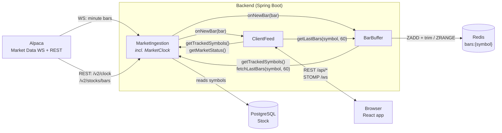
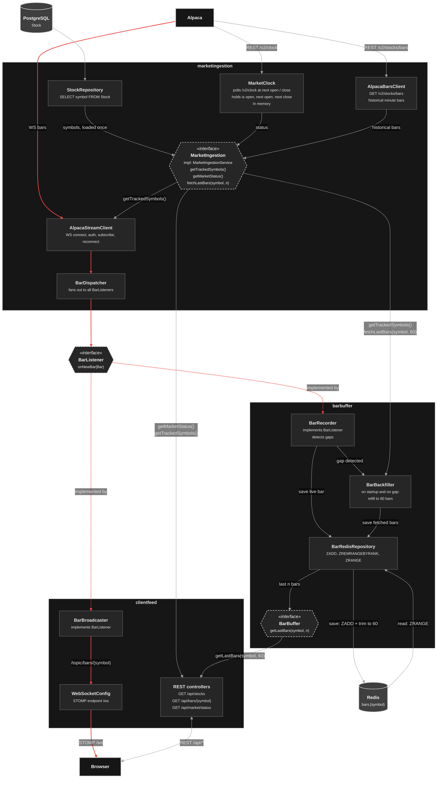

# OMAN Finance backend module diagram

## 1. Module view

## 2. Component view

Arrows in this view show the direction data flows. The red path is a live
bar travelling from Alpaca to the browser. Dashed hexagons are interfaces.

## 3. Reading the diagrams

- Hexagons are the public contracts between modules. All other components are
  package-private to their module.
- `BarListener` is a shared contract in a common package. `MarketIngestion`
  depends only on the interface; Spring injects every `BarListener` bean into
  `BarDispatcher`.
- Dependencies point one way: `ClientFeed` depends on `BarBuffer` and
  `MarketIngestion`; `BarBuffer` depends on `MarketIngestion`;
  `MarketIngestion` depends on no other module.
- `BarBuffer` always holds the last 60 bars per symbol. The live stream
  alone would leave it empty after startup or with holes after a reconnect, so
  `BarBackfiller` fills it from `MarketIngestion.fetchLastBars(symbol, 60)`:
  - at startup, for every symbol from `getTrackedSymbols()`;
  - when `BarRecorder` sees a gap (a new bar more than one minute after the
    previous one while the market is open).
  Bars are keyed by timestamp, so refetched bars overwrite existing ones
  instead of duplicating them.
- `fetchLastBars` calls Alpaca's historical bars endpoint through
  `AlpacaBarsClient`. When the market is closed it returns the last bars of the
  previous session.
- `MarketIngestionService` loads the symbols from PostgreSQL once at startup.
  `AlpacaStreamClient` and `ClientFeed` both get them through
  `getTrackedSymbols()`, so `StockRepository` has a single caller.
- `MarketClock` keeps the market status (`is_open`, `next_open`,
  `next_close`) in memory, not in Redis. It calls Alpaca `/v2/clock` at
  startup, again at the next open or close, and on a periodic safety-net
  refresh. `getMarketStatus()` is delegated to it.
- Redis holds only `bars:{symbol}`, owned by `BarBuffer`.
- Market status is currently pull-only through REST. Pushing status changes on
  `/topic/market-status` is a possible extension.
- REST endpoint names are provisional.
