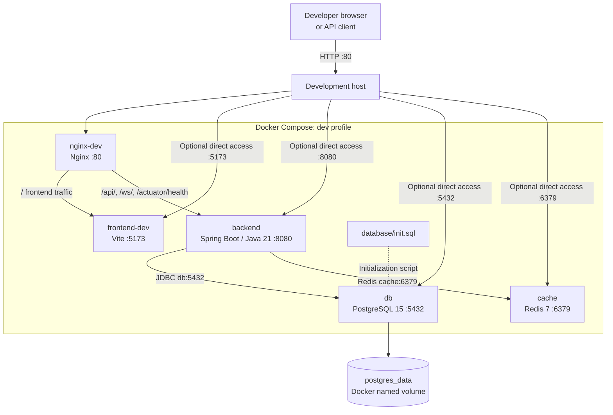
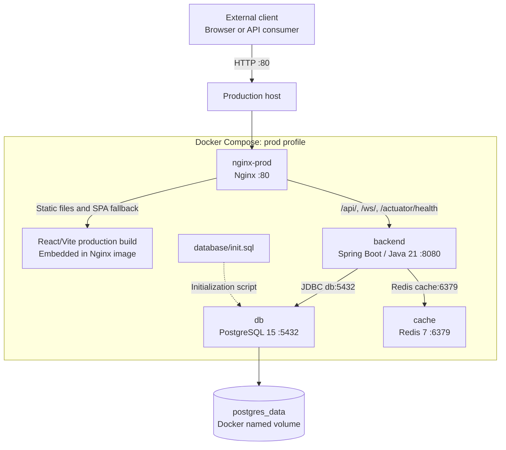

# OMAN Finance physical architecture

## 1. Scope

This document describes the deployable infrastructure defined by
[`docker-compose.yml`](../docker-compose.yml), the Nginx routing configuration,
and the application container Dockerfiles. It is a container-level physical
architecture, not a description of the internal Java or React class structure.

## 2. Physical deployment view

The diagram represents one Docker host running the Compose project. The Docker
bridge network provides service-name DNS, so containers address one another as
`db`, `cache`, `backend`, and `frontend-dev`; these names are not public DNS
names.

### Development deployment diagram

The development profile runs Nginx in front of the Vite development server.
The frontend source is bind-mounted for hot reload. PostgreSQL and Redis are
published only to the host loopback interface for local development, testing,
and administration.

### Production deployment diagram

The production profile serves the compiled React/Vite files directly from the
Nginx image. The Compose configuration also maps PostgreSQL and Redis to
loopback-only host ports for local administration; application traffic still
reaches them through the Docker network.
Docker Compose creates the `finance-network` bridge network automatically;
it is an implementation detail of the container deployment and is therefore
described in the note rather than shown as a separate architecture node. The
`postgres_data` volume is shown outside the Compose service block because it is
Docker-managed persistent storage, not a running container.

## 3. Physical nodes and responsibilities

| Node/container | Image or build                                                                | Internal port |      Published host port | Responsibility                                                                     |
| -------------- | ----------------------------------------------------------------------------- | ------------: | -----------------------: | ---------------------------------------------------------------------------------- |
| `nginx-prod`   | Custom image from [`nginx/Dockerfile.prod`](../nginx/Dockerfile.prod)         |            80 | `${NGINX_HTTP_PORT:-80}` | Production entry point, static React asset server, API and WebSocket reverse proxy |
| `nginx-dev`    | `nginx:alpine`                                                                |            80 | `${NGINX_HTTP_PORT:-80}` | Development entry point and proxy to the Vite server and backend                   |
| `backend`      | Multi-stage build from [`backend/Dockerfile`](../backend/Dockerfile)          |          8080 |                     8080 | Spring Boot application and API                                                    |
| `frontend-dev` | `node:20-alpine` from [`frontend/Dockerfile.dev`](../frontend/Dockerfile.dev) |          5173 |                     5173 | Vite development server with source bind mount and hot reload                      |
| `db`           | `postgres:15`                                                                 |          5432 |         `127.0.0.1:5432` | Persistent relational database                                                     |
| `cache`        | `redis:7-alpine`                                                              |          6379 |         `127.0.0.1:6379` | Redis cache used by the backend; localhost administration/testing                  |

Only one of `nginx-dev` and `nginx-prod` should be enabled at a time because
both claim the same host HTTP port. The Compose profiles are `dev` and `prod`.
The database and cache have no profile and are started in either deployment
variant.

## 4. Network topology and request paths

All services attach to the user-defined bridge network `finance-network`.
Containers communicate over their container ports; host port mappings are not
used for service-to-service traffic.

### Production

1. A browser connects to the host's Nginx port.
2. `nginx-prod` serves the React/Vite build from `/usr/share/nginx/html`.
3. Requests under `/api/` are proxied to `http://backend:8080`.
4. Requests under `/ws/` are proxied to the backend with WebSocket upgrade
   headers and buffering disabled.
5. The exact path `/actuator/health` is proxied to the backend. Other actuator
   paths are not explicitly exposed by Nginx.
6. Client-side routes fall back to `/index.html`.

The production image builds the frontend in a Node 20 build stage and copies
the resulting `dist` directory into an Nginx Alpine runtime image.

### Development

1. A browser connects to `nginx-dev` on the configured HTTP port.
2. `nginx-dev` proxies frontend traffic to `http://frontend-dev:5173`.
3. `/api/`, `/ws/`, and `/actuator/health` still go directly to
   `http://backend:8080`.
4. `frontend-dev` uses the bind-mounted `frontend` directory and Vite polling
   for container-friendly hot module reloading.

The development frontend is also reachable directly from the host on port
5173, the backend is reachable directly on port 8080, PostgreSQL on
`127.0.0.1:5432`, and Redis on `127.0.0.1:6379`. These direct ports are useful
for development and administration but bypass Nginx routing and its HTTP
headers.

## 5. Data and persistence

- PostgreSQL data is stored in the named Docker volume `postgres_data`, mounted
  at `/var/lib/postgresql/data`. Removing the container does not remove this
  data; removing the named volume does.
- [`database/init.sql`](../database/init.sql) is mounted into PostgreSQL's
  initialization directory. It creates the initial `Stock` table when the
  database volume is initialized. PostgreSQL initialization scripts do not
  automatically rerun on an already-initialized volume.
- Redis has no volume in the Compose definition. Its cache is therefore
  container-lifetime state and can be lost when the Redis container is
  recreated.
- Database credentials, datasource settings, Redis settings, CORS origins, and
  frontend API settings are supplied through environment substitution, normally
  from `.env`. Secrets should not be committed to the repository.

The backend validates the existing schema rather than creating or modifying
it (`ddl-auto=validate`). Schema evolution therefore requires an explicit
database migration mechanism.

## 6. Startup and health dependencies

- PostgreSQL has a `pg_isready` health check.
- Redis has a `redis-cli ping` health check.
- The backend waits for PostgreSQL to become healthy before Compose starts it.
- The backend does not currently declare a Compose health dependency on Redis.
- Nginx has no Compose health check or explicit dependency on the backend in the
  production profile. The `/actuator/health` route is available for external
  monitoring through Nginx.
- All services use `restart: unless-stopped`.

## 7. Build and runtime boundaries

### Backend image

The backend uses a multi-stage build:

1. `gradle:8.14-jdk21` compiles the Spring Boot JAR.
2. `eclipse-temurin:21-jre` runs only the resulting JAR on port 8080.

Build tooling and source code are not required in the runtime image.

### Frontend production image

The frontend is built with Node 20 and then served by `nginx:stable-alpine`.
There is no standalone production frontend container in this mode; the static
frontend is physically colocated with the production Nginx process.

### Frontend development image

The development image runs Node 20 and Vite on port 5173. The source directory
is bind-mounted from the host, while `/app/node_modules` is kept in an
anonymous container volume so host dependencies do not overwrite container
dependencies.

## 8. Operational boundaries and current limitations

- The current Compose topology is suitable for a single Docker host. It does
  not define replicas, load balancing across backend instances, orchestration,
  or a separate managed database.
- HTTPS is not active. The HTTPS port and certificate mounts are present only
  as commented placeholders in the Compose and Nginx configuration.
- PostgreSQL and Redis are published only on the host loopback interface for
  local development, testing, and administration. They remain unavailable
  through external host interfaces. For a hardened production deployment,
  remove these host mappings and use the Docker network or
  `docker compose exec` for administration.
- Nginx applies response security headers, compression, static-asset caching,
  upload-size limits, and longer WebSocket timeouts at the edge.
