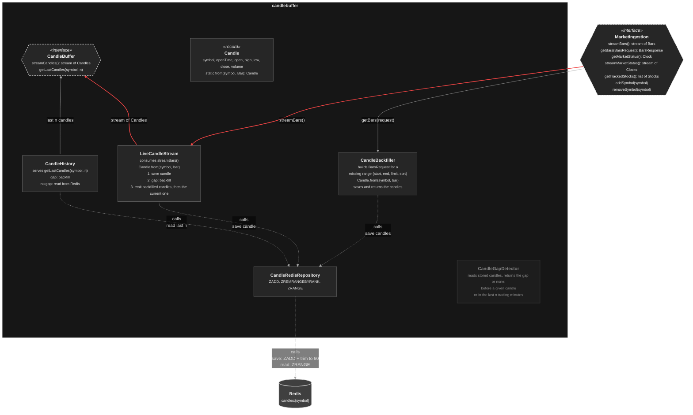

# CandleBuffer

Turns raw bars into candles and keeps the last 60 trading minutes of candles
per symbol complete and ready to serve.

Part of the [backend module overview](modular-architecture.md).

## Component diagram

Solid arrows show the direction data flows. Dashed arrows labeled "calls"
point from the caller to the component it calls. The red path is the live
bar, from `streamBars()` through `LiveCandleStream` to the `CandleBuffer`
interface. `CandleGapDetector` is not built yet, so it sits in the module
with no connections.

Hexagons are public interfaces. `MarketIngestion` appears only as its
interface. Other nodes in the module box are package-private, except the
`Candle` record, which the interface uses. Redis (`candles:{symbol}`) is the
only external system this module connects to.

## Notes

- **Bar vs. candle.**
  - **Bar:** A `Bar` is the raw minute bar exactly as Alpaca sends it
    (`t, o, h, l, c, v, n, vw`). Raw bars are cached under `bars:{symbol}`
    by `MarketIngestion`; see [marketingestion.md](marketingestion.md).
  - **Candle:** A `Candle` is our backend object (symbol, open time, open,
    high, low, close, volume). The only place that turns a bar into a candle
    is the static factory method `Candle.from(symbol, bar)`; `LiveCandleStream`
    and `CandleBackfiller` both call it. The symbol is passed separately
    because a raw bar does not carry it.

  Both are saved in Redis under different keys, so the same minute can exist
  twice in two shapes:
  - `bars:{symbol}`: raw bars from `/v2/stocks/bars` responses, owned by
    `MarketIngestion`. Live bars from the WebSocket are not saved raw;
  - `candles:{symbol}`: candles, owned by `CandleBuffer`, last 60 per symbol.
- **`CandleBuffer` decides what data it needs.** `CandleGapDetector` is the
  only component that decides which candles are missing. It compares the
  stored candles with the trading minutes (from `getMarketStatus()`) and
  hands every missing range to `CandleBackfiller`. It runs:
  - at startup, for every stock from `getTrackedStocks()`;
  - on each live candle from `LiveCandleStream` (a new candle more than one
    trading minute after the last stored one);
  - before each `getLastCandles(symbol, n)` read (fewer than n candles, or a
    missing minute between them). The read waits for the backfill and then
    returns the full n, so `getLastCandles(symbol, 60)` always returns 60
    candles.

  "Last 60" means the last 60 trading minutes, not the last 60 clock minutes:
  when the market is closed the check looks at the end of the previous
  session, and nights and weekends do not count as gaps.

  `CandleBackfiller` has no detection logic. For each missing range it
  builds the `BarsRequest` itself: symbol, `timeframe=1Min` and only that
  range (`start`, `end`, `limit`, `sort`). `AlpacaRestBarsClient` adds `feed=iex`
  (the only feed with recent data on the free plan). The backfiller then
  converts the bars with `Candle.from` and saves them. `CandleRedisRepository`
  only stores and reads candles. Candles are keyed by timestamp, so refetched
  candles overwrite existing ones instead of duplicating them.
- **This iteration implements only the happy path.** We assume the Alpaca
  WebSocket never fails, so no gaps appear in the live data. Until that
  changes:
  - `CandleGapDetector` is not built;
  - `LiveCandleStream` saves each candle directly to Redis;
  - `CandleBackfiller` runs only at server startup, to fill the first 60
    candles per symbol;
  - `CandleHistory` only reads the last candles from Redis.

  The diagram still shows `CandleGapDetector`, on its own, so it is ready if we add it later.
- **Errors from `getBars`.** `CandleBackfiller` handles
  `AlpacaConfigException` and `AlpacaUnavailableException`. The status
  codes, the single 429 retry and the timeouts are in
  [marketingestion.md](marketingestion.md).
