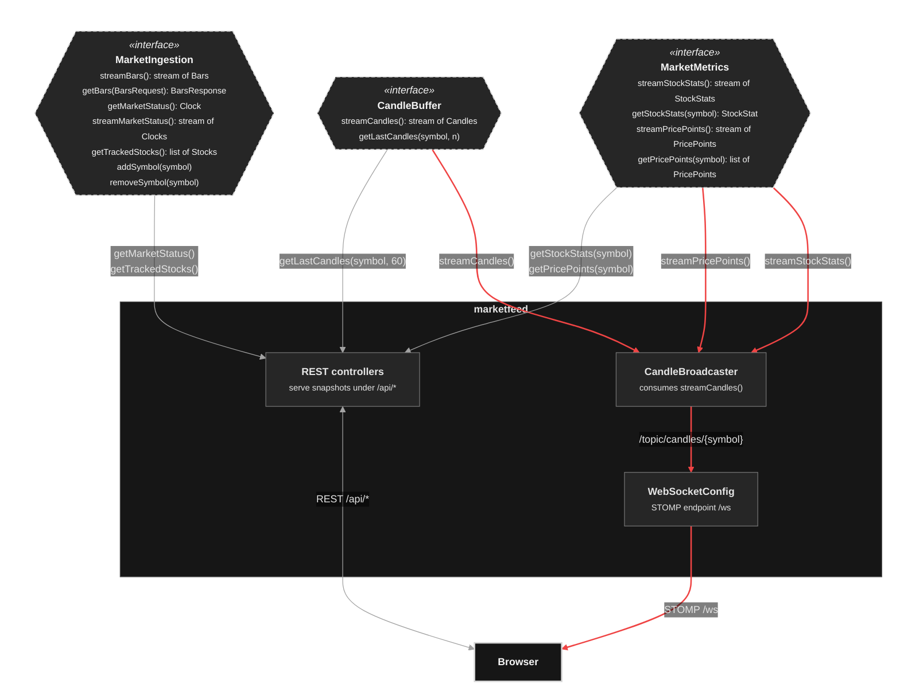

# MarketFeed

The backend's interface to the browser. It serves snapshots over REST and
pushes live updates over WebSocket.

Part of the [backend module overview](modular-architecture.md).

## Component diagram

Solid arrows show the direction data flows. The red path is a live update,
from `streamCandles()`, `streamStockStats()` and `streamPricePoints()`
through `CandleBroadcaster` and the STOMP endpoint to the browser.

Hexagons are the public interfaces of the modules this one depends on.
Those modules appear only as their interface. The browser is the only
external system this module connects to.

## Notes

- MarketFeed never sees Alpaca's HTTP client exceptions.
  `CandleBackfiller` and `MarketStatusTracker` handle
  `AlpacaConfigException` and `AlpacaUnavailableException`. The status
  codes, the single 429 retry and the timeouts are in
  [marketingestion.md](marketingestion.md).
