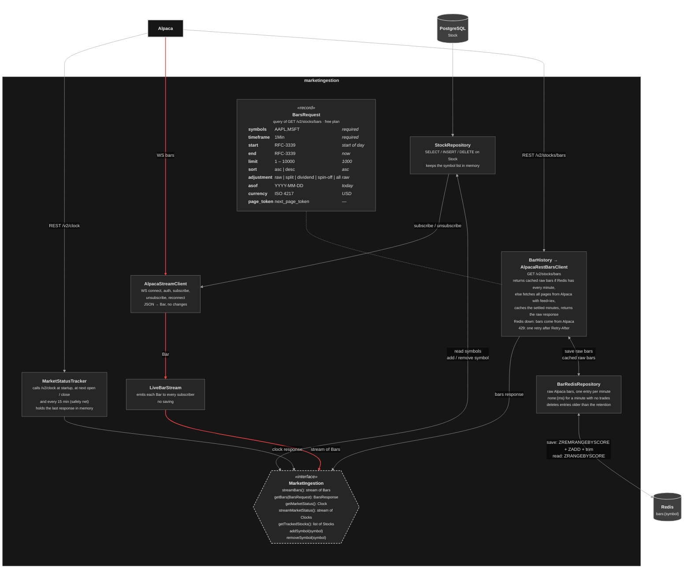

# MarketIngestion

The backend's only connection to Alpaca. It brings market data and market
status into the system unchanged and makes them available to the other
modules.

Part of the [backend module overview](modular-architecture.md).

## Component diagram

Solid arrows show the direction data flows. The red path is a live bar from
Alpaca's WebSocket through `AlpacaStreamClient` and `LiveBarStream` to the
`MarketIngestion` interface.

The hexagon is the public interface. Other nodes in the module box are
package-private, except the `BarsRequest` record, which the interface uses.
Alpaca, PostgreSQL and Redis sit outside the module; this module is the only
one that connects to them for market data.

## Notes

- **Bar vs. candle.**
  - **Bar:** A `Bar` is the raw minute bar exactly as Alpaca sends it
    (`t, o, h, l, c, v, n, vw`).
  - **Candle:** A `Candle` is our backend object (symbol, open time, open,
    high, low, close, volume). The only place that turns a bar into a candle
    is the static factory method `Candle.from(symbol, bar)`; `LiveCandleStream`
    and `CandleBackfiller` both call it. The symbol is passed separately
    because a raw bar does not carry it. See
    [candlebuffer.md](candlebuffer.md).

  Both are saved in Redis under different keys, so the same minute can exist
  twice in two shapes:
  - `bars:{symbol}`: raw bars from `/v2/stocks/bars` responses, owned by
    `MarketIngestion` and saved by `BarHistory` through
    `BarRedisRepository`. It works as a cache, described below. Live bars
    from the WebSocket are not saved raw;
  - `candles:{symbol}`: candles, owned by `CandleBuffer`, last 60 per symbol.
- **The raw bar cache (`bars:{symbol}`).** A sorted set scored by minute in
  epoch ms, with **one entry for every fetched minute**: the bar as JSON, or
  `none:{epoch ms}` when Alpaca sent no bar because there were no trades. A
  minute with no entry was never fetched. This is what lets the cache tell
  "no trades" apart from "never fetched", which the bars alone cannot.
  - **Read:** `getBars` answers from Redis only when every requested symbol
    has as many entries as there are minutes in the range. Otherwise it asks
    Alpaca for the whole request.
  - **Save:** after an Alpaca fetch, each symbol's range is replaced in one
    `MULTI`: the old entries are removed, then the bars and `none` entries
    are added. A range can be cached next to another one with a gap between
    them; the gap simply has no entries.
  - **Only settled minutes are cached:** minutes that ended at least 1 minute
    ago, because Alpaca may still be building the bar of a minute that just
    ended. A request that ends at "now" is therefore always answered by
    Alpaca; the cache helps with ranges in the past, such as the last
    session after the close.
  - **What can be cached:** 1-minute bars, `adjustment=raw`, `USD`, no
    `asof`, no `page_token`, `start` and `end` on whole minutes. Anything
    else goes straight to Alpaca and is not saved.
  - **Retention:** every save deletes that symbol's entries older than
    `alpaca.bar-cache-retention` (7 days by default). A deleted minute counts
    as never fetched.
  - **Redis down:** the cache only saves Alpaca calls. `getBars` logs a
    warning and returns the bars from Alpaca. Redis timeouts are 1 s, so a
    dead Redis does not stall it.
  - Either way the caller gets the same bars Alpaca would send: values are
    not checked or changed, and `none` entries never leave the repository.
- **Alpaca errors.** Every REST call to Alpaca goes through
  `AlpacaRestErrorHandling`, so callers of `MarketIngestion` never see Spring's
  HTTP client exceptions:
  - **401 / 403** → `AlpacaConfigException`. Its message says to check
    `ALPACA_API_KEY_ID` and `ALPACA_API_SECRET_KEY`. It is not logged here;
    the caller decides how to report it. Retrying does not help.
  - **429** → wait for `Retry-After` (seconds; 1 s when it is missing or not
    a number), at most `alpaca.max-retry-wait` (30 s by default), then send
    the request once more. A second 429 → `AlpacaUnavailableException`.
  - **5xx, a timeout or a broken connection** →
    `AlpacaUnavailableException`, with the I/O error as the cause. The
    connect and read timeouts are `alpaca.connect-timeout` (5 s) and
    `alpaca.read-timeout` (10 s).
  - The caller (`CandleBackfiller`, `MarketStatusTracker`) handles both exceptions;
    MarketFeed never sees them.
- `MarketStatusTracker` keeps the market status in memory, not in Redis. It calls
  Alpaca `GET /v2/clock` on the trading API (`alpaca.trading-base-url`):
  - **Startup:** while the bean is created, so `getMarketStatus()` has a
    value before the web server starts and before `CandleBackfiller` runs.
    When Alpaca is unavailable it tries 3 times, waiting 2 s and then 4 s; if
    it still fails, or Alpaca rejects the API keys, the backend does not
    start.
  - **At the next open or close:** 5 s after `next_close` when the market is
    open, or `next_open` when it is closed, as Alpaca reported them. Early
    closes and holidays therefore need no calendar of our own. The wait is
    counted from Alpaca's `timestamp`, so a skewed server clock does not move
    it; the 5 s keep timer and network delays from landing the call just
    before the boundary. When the boundary has already passed, it waits 5 s.
  - **Safety net:** every `alpaca.clock-refresh-interval` (15 min by
    default).
  - Every successful response replaces the held status and the pending
    open/close call. A failed call (`AlpacaUnavailableException`,
    `AlpacaConfigException`) is logged and keeps the old status; the next
    safety-net call corrects it, so a failed call at the close leaves the
    status wrong for at most one interval.
  - `streamMarketStatus()` emits every response, safety-net ones included,
    and gives a new subscriber the current status first, as
    `stomp_contract.yaml` requires for `/topic/market/status`.
- `StockRepository` loads the symbols from PostgreSQL at startup and keeps
  the list in memory. `AlpacaStreamClient` subscribes to them; other modules
  read them, with their company names, through `getTrackedStocks()`.
- `addSymbol(symbol)` and `removeSymbol(symbol)` change the tracked symbols at
  runtime:
  - `addSymbol` inserts the row into `Stock`, updates the in-memory list and
    sends a `subscribe` message on the open Alpaca WebSocket;
  - `removeSymbol` deletes the row, updates the list and sends `unsubscribe`.
  Alpaca accepts both messages on a live connection, so no reconnect is
  needed. Adding a symbol that is already tracked, or removing one that is
  not, does nothing.

## Notes for next iteration

- `StockRepository`, `addSymbol` and `removeSymbol` will move out of
  `MarketIngestion` into a separate module that owns the `Stock` table.
  `MarketIngestion` will then only read the tracked symbols and subscribe or
  unsubscribe on the Alpaca WebSocket.
