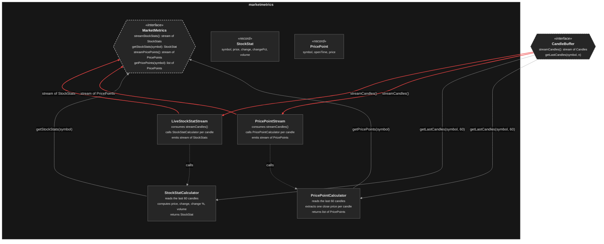

# MarketMetrics

Derives market-facing statistics from candles. It subscribes to
CandleBuffer's candle stream and computes the values the frontend needs for
stock overviews and sparkline graphs.

Part of the [backend module overview](modular-architecture.md).

## Component diagram

Solid arrows show the direction data flows. Dashed arrows labeled "calls"
point from the caller to the component it calls. The red path is a live
candle, from `streamCandles()` through the live streams to the
`MarketMetrics` interface.

Hexagons are public interfaces. `CandleBuffer` appears only as its
interface. Other nodes in the module box are package-private, except the
`StockStat` and `PricePoint` records, which the interface uses. This module
connects to no external system; it holds no persistent state of its own.

## Notes

The component write-up has no separate notes for this module. The
calculators read the last 60 candles through `CandleBuffer` and return
`StockStat` and `PricePoint`; nothing here is stored.
