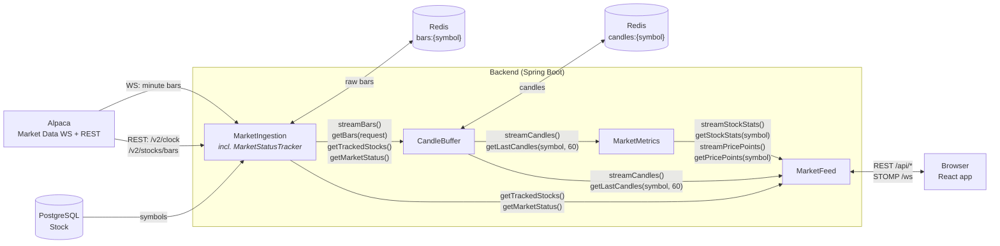

# OMAN Finance backend module diagram

Component diagrams and the notes for each module:
[marketingestion.md](marketingestion.md),
[candlebuffer.md](candlebuffer.md),
[marketmetrics.md](marketmetrics.md),
[marketfeed.md](marketfeed.md).

## 1. Module Overview

Arrows show the direction data flows.

## 2. Module Descriptions

### MarketIngestion

**Purpose:** The backend's only connection to Alpaca. It brings market data
and market status into the system unchanged and makes them available to the
other modules.

**Responsibilities:**

- Keep one WebSocket connection to Alpaca open: authenticate, subscribe to
  the tracked symbols and reconnect when the connection drops.
- Turn incoming WebSocket messages into bars without changing their values
  and hand every live bar to each module that listens.
- Fetch historical minute bars from Alpaca's REST API on request, save the
  raw bars in Redis and return them unchanged. If Redis already has every
  minute of the requested range, return the cached raw bars instead of
  calling Alpaca again. If Redis is down, get the bars from Alpaca.
- Track whether the market is open/closed.
- Keep the list of tracked symbols: load it from PostgreSQL at startup, hold
  it in memory and add or remove symbols at runtime, updating the WebSocket
  subscription without reconnecting.
- Contain no business logic: whatever Alpaca returns is passed on as is.

**Owns:**

- the Alpaca WebSocket connection and API credentials;
- raw bars in Redis (`bars:{symbol}`);
- the `Stock` table in PostgreSQL and the in-memory symbol list.
- the in-memory market status.

**Dependencies:** none.

Component diagram and notes: [marketingestion.md](marketingestion.md).

### CandleBuffer

**Purpose:** Turns raw bars into candles and keeps the last 60 trading
minutes of candles per symbol complete and ready to serve.

**Responsibilities:**

- Listen to live bars, convert each bar into a candle with
  `Candle.from(symbol, bar)`, save it and only then pass it on, so every
  candle a client receives is already stored.
- Keep only the latest 60 candles per symbol in Redis.
- Decide in one place which trading minutes are missing: at startup for
  every tracked symbol, on each live candle and before each read. Nights and
  weekends do not count as gaps.
- Backfill the missing ranges from historical bars. The module decides which
  time range to request.
- Serve the last 60 candles of a symbol, waiting for a backfill if needed,
  so the result is always complete.
- Key candles by timestamp so refetched data overwrites instead of
  duplicating.

**Owns:**

- candles in Redis (`candles:{symbol}`);
- the `Candle` model and the only Bar → Candle conversion
  (`Candle.from(symbol, bar)`);
- the rules for what counts as a gap and how missing data is filled.

**Dependencies:** MarketIngestion (live bars, historical bars, tracked
symbols, market status).

Component diagram and notes: [candlebuffer.md](candlebuffer.md).

### MarketMetrics

**Purpose:** Derives market-facing statistics from candles. It subscribes to
CandleBuffer's candle stream and computes values that the frontend needs to
display stock overviews and sparkline graphs.

**Responsibilities:**

- Subscribe to CandleBuffer's live candle stream and, for each new candle,
  recompute the statistics for that symbol from the last 60 candles.
- Compute `StockStat` (current price, absolute change, percentage change,
  volume) from the last 60 candles of a symbol.
- Compute `PricePoint` (a single price extracted from a candle, for
  sparkline graphs) from the last 60 candles of a symbol.
- Emit each newly computed `StockStat` and `PricePoint` on its own streams.
- Serve on-demand requests: `getStockStats(symbol)` and
  `getPricePoints(symbol)` for API.
- Contain no storage logic: it reads candles through CandleBuffer's
  interface and holds no persistent state of its own.

**Owns:**

- the `StockStat` model (price, change, change%, volume);
- the `PricePoint` model (a single price from a candle);
- the calculation logic that turns a window of candles into those models.

**Dependencies:** CandleBuffer (live candle stream, last 60 candles).

Component diagram and notes: [marketmetrics.md](marketmetrics.md).

### MarketFeed

**Purpose:** The backend's interface to the browser. It serves snapshots
over REST and pushes live updates over WebSocket.

**Responsibilities:**

- Serve REST endpoints and host the STOMP-over-WebSocket endpoint
  that browsers connect to.
- Listen to live candles from CandleBuffer and publish each one to the topic
  of its symbol.
- Subscribe to MarketMetrics's StockStat and PricePoint streams and push
  updates to the browser over WebSocket.
- Call MarketMetrics on API requests that need computed stats or price
  points.
- Convert internal models into the response format the frontend expects.
- Contain no market data or calculation logic and never access Alpaca or
  Redis directly.

**Owns:**

- the REST API (`/api/*`);
- the STOMP endpoint (`/ws`) and its topics (`/topic/candles/{symbol}`);

**Dependencies:** CandleBuffer (live candles, last 60 candles),
MarketMetrics (live StockStats and PricePoints, on-demand stats),
MarketIngestion (tracked symbols, market status).

Component diagram and notes: [marketfeed.md](marketfeed.md).
