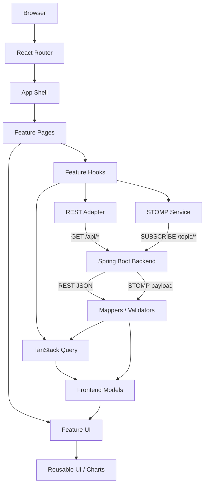
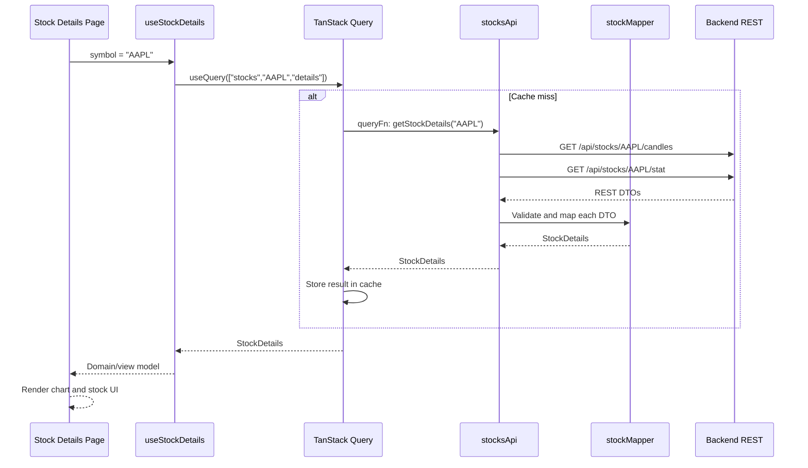
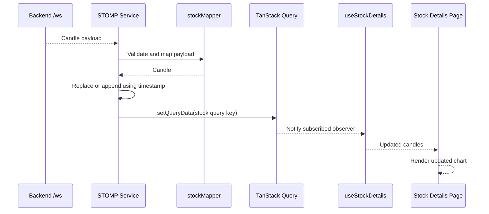
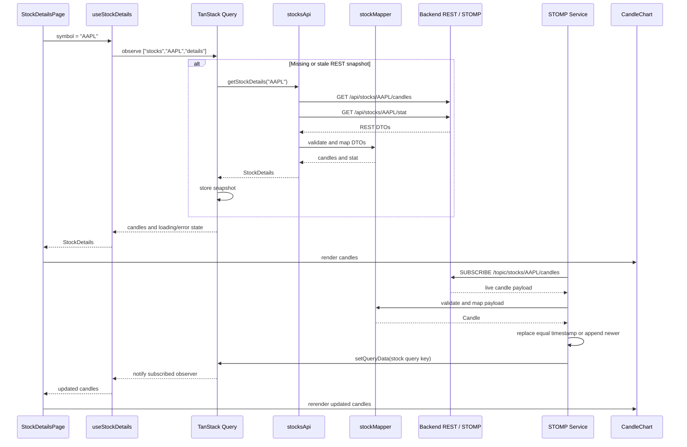
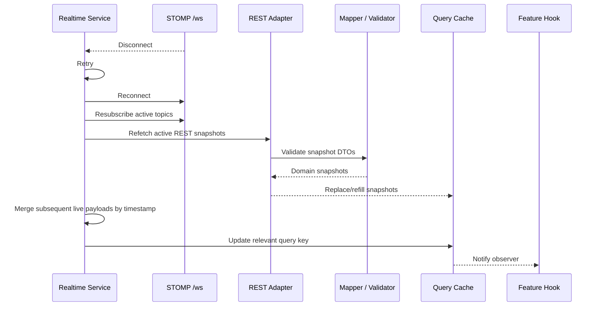
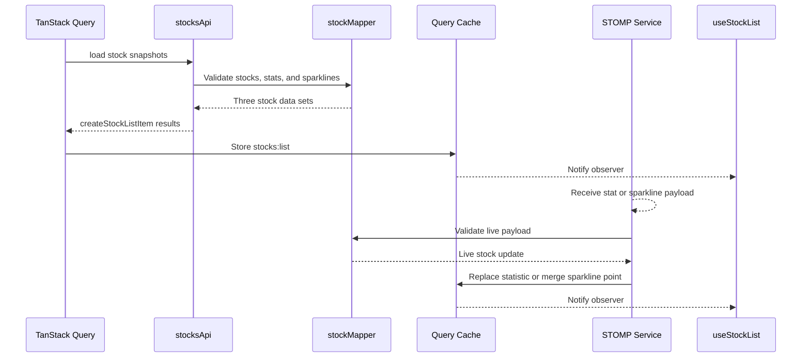

# OMAN Finance frontend architecture

## Scope

This architecture describes iteration 1:

- View the market status.
- View all tracked stocks.
- Sort stocks by symbol, price, or change.
- Open a stock details page.
- View 60 one-minute candles and volumes.
- Switch between line and candle charts.
- Receive live updates over STOMP.

Iteration 1 has no login, account, portfolio, order, or trading feature. The
architecture includes stable boundaries so those features can be added later
without rewriting market and stock code.

## Architecture overview



## Communication rules

| Block            | May communicate with                  | Must not communicate with    |
| ---------------- | ------------------------------------- | ---------------------------- |
| Route page       | Feature hook, feature UI, route state | HTTP, STOMP, backend DTOs    |
| Feature hook     | Query, REST adapter, realtime service | HTML or chart implementation |
| Query cache      | Feature hooks                         | Backend endpoints directly   |
| REST adapter     | Backend `/api/*`, validators          | UI components and pages      |
| STOMP service    | Backend `/ws`, topic registry         | Individual pages             |
| Mapper/validator | API payloads and frontend models      | React components             |
| Feature UI       | Props and callbacks                   | Fetching and WebSocket logic |
| UI primitives    | Props only                            | Feature state and backend    |

The dependency direction is:

```text
pages -> hooks -> infrastructure
pages -> feature components -> reusable UI
```

Infrastructure must never import pages or feature components.

## Module descriptions

### Application shell

**Files**

```text
src/app/
  App.tsx
  AppShell.tsx
  env.ts
  providers/
  router/
```

**Responsibilities**

- Configure React Router and shared providers.
- Render layouts and navigation.
- Define global loading and error integration.

The shell must not contain market fetching or stock data assembly.

**Future extension**

Later features can add route guards and application providers here without
changing feature components.

### Router

**Iteration routes**

```text
/                         Stock market overview
/stocks/:symbol            Stock details
```

The symbol is a route parameter, not local state in `App`. React Router should
own navigation and browser history.

**Future extension**

Additional features use independent route groups, for example
`/portfolio`, `/trade`, or `/orders`.

### UI primitives

**Files**

```text
src/components/ui/
  Button.tsx
  Card.tsx
  Table.tsx
  Badge.tsx

src/components/layouts/
  PageLayout.tsx
  AppLayout.tsx
```

**Responsibilities**

- Reusable accessible controls and layout.
- Design tokens and Tailwind variants.
- Loading, error, empty, and disabled presentations.

UI primitives receive props and callbacks only. They do not know about stocks,
REST, or STOMP.

### Charts

**Files**

```text
src/components/charts/
  LineChart.tsx
  Sparkline.tsx
  CandleChart.tsx
  VolumeChart.tsx
```

**Responsibilities**

- Reusable chart rendering.
- Time and price formatting.
- Hover tooltips and accessible labels.

Feature hooks provide chart-ready data. Charts must not fetch or subscribe.

### Feedback

**Files**

```text
src/components/feedback/
  Loading.tsx
  EmptyState.tsx
  ErrorState.tsx
  RetryButton.tsx
```

Every REST or realtime feature should present consistent loading, error,
empty, stale, and retry states.

### Market feature

**Files**

```text
src/features/market/
  api/marketApi.ts
  api/marketStatusDto.ts
  model/market.ts
  hooks/useMarketStatus.ts
  mappers/marketMapper.ts
  mocks/marketStatusMock.ts
  components/MarketStatus.tsx
  pages/MarketPage.tsx
  tests/
```

**Responsibilities**

- `GET /api/market/status`.
- Subscribe to `/topic/market/status`.
- Validate and cache market status.
- Display open/closed status and relevant dates.

The market feature model uses `Date` for timestamps. REST and STOMP payloads
remain RFC 3339 strings at the transport boundary; `marketMapper` validates
those strings and converts them to `Date` before the data enters the Query
Cache. This keeps timestamp comparisons and date formatting consistent.

**Future extension**

Trading windows or account features can consume the shared market-status model
without duplicating status fetching.

### Stocks feature

**Files**

```text
src/features/stocks/
  api/stocksApi.ts
  model/stock.ts
  hooks/useStockList.ts
  hooks/useStockDetails.ts
  hooks/useStockRealtime.ts
  mappers/stockMapper.ts
  mocks/stockMocks.ts
  components/StockTable.tsx
  components/StockRow.tsx
  components/StockHeader.tsx
  components/StockChart.tsx
  pages/StocksPage.tsx
  pages/StockDetailsPage.tsx
  tests/
```

**Responsibilities**

- Load stock identities.
- Load statistics and sparklines.
- Load and display 60 one-minute candles.
- Sort stocks by symbol, price, or change.
- Merge live stat, sparkline, and candle updates.
- Switch stock details between line and candle display.

REST endpoints:

```text
GET /api/stocks
GET /api/stocks/stat
GET /api/stocks/sparkline
GET /api/stocks/{symbol}/stat
GET /api/stocks/{symbol}/candles
```

STOMP topics:

```text
/topic/stocks/stat
/topic/stocks/sparkline
/topic/stocks/{symbol}/stat
/topic/stocks/{symbol}/candles
/topic/market/status
```

This feature owns stock data assembly. It replaces the current
`src/data/*` orchestration and `src/mappers/*` modules.

**Future extension**

Portfolio, watchlists, trading, and order features can reuse the stock identity,
stat, candle, and realtime models under separate feature folders.

### REST infrastructure

**Files**

```text
src/lib/http/
  client.ts
  errors.ts
  request.ts
```

**Responsibilities**

- Shared fetch configuration.
- Abort and cancellation handling.
- HTTP error conversion.
- JSON parsing and response validation hooks.

Each feature owns its endpoint definitions and Query keys.

### Realtime infrastructure

**Files**

```text
src/lib/realtime/
  stompClient.ts
  subscriptions.ts
  cacheUpdates.ts
```

**Responsibilities**

- One shared STOMP connection.
- Typed topic subscriptions.
- Automatic reconnect and resubscription.
- Snapshot refresh after reconnect.
- Timestamp-based cache merge rules.

No page or chart should create a STOMP client.

**Future extension**

Future authentication may require connection credentials. Keep credentials and
authorization in the realtime infrastructure while preserving the same
subscription and cache-update API.

## State model

| State                 | Technology                  | Owner                   |
| --------------------- | --------------------------- | ----------------------- |
| REST snapshots        | TanStack Query              | Feature hooks           |
| Live market updates   | STOMP service + Query Cache | Realtime infrastructure |
| Route state           | React Router                | Router                  |
| Component-local state | React `useState`            | Component               |
| Form state            | React Hook Form             | Future feature          |
| Shared UI state       | Zustand only if necessary   | App shell               |

Redux is not needed initially. TanStack Query is the source of truth for server
state.

## API DTOs and UI models

```text
docs/api_contract.yaml
  -> npm run generate:api-types
  -> src/types/api.generated.ts
  -> feature/chart mapper validates DTO and maps to UI model
  -> TanStack Query cache
  -> hooks and UI
```

`src/types/api.generated.ts` contains generated REST DTO types and must not be
edited manually. The REST contract is the source of truth. Run
`npm run generate:api-types` from `frontend/` after changing the contract.
Generated DTOs describe the wire format, including RFC 3339 timestamp strings.

Feature and chart models describe frontend needs instead. For example,
`MarketStatus.timestamp` and stock/chart timestamps are `Date` instances after
mapping. `StockListItem` is the stock-list UI model, assembled from generated
`Stock`, `StockStat`, and `Sparkline` DTOs. DTO validation and conversion to UI
models happen before data is stored in the Query Cache.

Chart components share only chart input models from
`components/charts/model/chartTypes.ts`. API payload validation and conversion
to those models stay in the owning feature mapper (for example,
`features/stocks/mappers/stockMapper.ts`), because different features and
endpoints may have different wire formats.

```text
REST JSON
  -> marketApi: validate as generated MarketStatusDto
  -> marketMapper: MarketStatusDto -> MarketStatus UI model
  -> Query Cache
  -> useMarketStatus
  -> page/UI
```

Generated types prevent manually maintained copies of the OpenAPI schemas. UI
model types remain hand-authored because they represent frontend needs rather
than the backend wire format. STOMP market-status messages use the same
runtime DTO validator and mapper as REST responses.

## Initial REST flow



The stock hook observes the query. TanStack Query invokes `stocksApi`, stores
the returned result, and sends cache updates to hooks subscribed to the same
query key. The mapper only validates and converts data; it does not access
TanStack Query.

## Live update flow



For each update:

1. Validate its payload.
2. Compare its timestamp with cached timestamps.
3. Replace a point with the same timestamp.
4. Append a newer point.
5. Drop points outside the 60-minute window.
6. Ignore messages older than the snapshot.

For a stock detail page, candle updates replace or append to the 60-candle
array. Stat updates replace the latest stock statistic.

The STOMP service updates the cache because it is the external owner of live
payloads. It may delegate payload conversion to the mapper and timestamp merge
rules to the stocks feature, but it must not call or update React pages
directly.

## Complete candle data flow



## Reconnect flow



A reconnect must not leave stale or duplicated market data. REST snapshot
refetch is required before or alongside the resubscription merge.

## Stocks list merge



Sorting belongs in the stocks feature and is derived from the stock list model.
It must not be hidden in a REST request or a chart component.

## Target file layout

```text
frontend/src/
  app/
    App.tsx
    AppShell.tsx
    env.ts
    providers/
    router/

  components/
    ui/
    charts/
    feedback/
    layouts/

  features/
    market/
      api/
      model/
      hooks/
      mappers/
      components/
      pages/
      tests/

    stocks/
      api/
      model/
      hooks/
      mappers/
      components/
      pages/
      tests/

  lib/
    http/
    realtime/
    validation/
    format/
    telemetry/
```

Feature folders are the unit of future growth. A future account or trading
feature should be added as another sibling directory rather than expanding
`App`, `MainPage`, or `StockDetailsPage`.

## Future-ready boundaries

Future login, portfolio, or trading features can add:

- A route group in the app router.
- A provider in `app/providers`.
- A feature-owned API and domain model.
- Feature-owned hooks and components.
- Route guards or layout variants.
- Realtime topics that update feature-owned Query keys.

The current architecture does not implement these features or add placeholder
authentication code.

## Testing

| Concern                       | Tool                                 |
| ----------------------------- | ------------------------------------ |
| Mapping and validation        | Vitest                               |
| Feature hooks                 | Vitest + React Testing Library       |
| Components                    | React Testing Library                |
| REST requests                 | MSW                                  |
| STOMP behavior                | Fake STOMP/WebSocket adapter         |
| Navigation and stock journeys | Playwright                           |
| Build and type safety         | `npm run typecheck`, `npm run build` |

Required scenarios:

- REST snapshot then live update.
- Reconnect followed by REST resnapshot.
- Older live payload ignored.
- Replacing and appending timestamps.
- Retaining no more than 60 points.
- Loading, error, empty, and retry states.
- Symbol, price, and change sorting.
- Stock route navigation.
- Malformed REST or STOMP payload.
- Line/candle chart switching.
