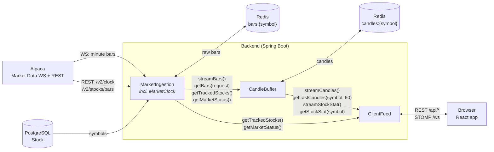

# OMAN Finance backend module diagram

## 1. Module Overview

Arrows show the direction data flows.

## 2. Module Descriptions

### MarketIngestion

**Purpose:** The backend's only connection to Alpaca. It brings market data
and market status into the system unchanged and makes them available to the
other modules.

**Responsibilities:**

- Keep one WebSocket connection to Alpaca open: authenticate, subscribe to
  the tracked symbols and reconnect when the connection drops.
- Turn incoming WebSocket messages into bars without changing their values
  and hand every live bar to each module that listens.
- Fetch historical minute bars from Alpaca's REST API on request, save the
  raw bars in Redis and return them unchanged. If Redis already has every
  minute of the requested range, return the cached raw bars instead of
  calling Alpaca again. If Redis is down, get the bars from Alpaca.
- Track whether the market is open/closed.
- Keep the list of tracked symbols: load it from PostgreSQL at startup, hold
  it in memory and add or remove symbols at runtime, updating the WebSocket
  subscription without reconnecting.
- Contain no business logic: whatever Alpaca returns is passed on as is.

**Owns:**

- the Alpaca WebSocket connection and API credentials;
- raw bars in Redis (`bars:{symbol}`);
- the `Stock` table in PostgreSQL and the in-memory symbol list.
- the in-memory market status.

**Dependencies:** none.

### CandleBuffer

**Purpose:** Turns raw bars into candles and keeps the last 60 trading
minutes of candles per symbol complete and ready to serve.

**Responsibilities:**

- Listen to live bars, convert each bar into a candle with
  `Candle.from(symbol, bar)`, save it and only then pass it on, so every
  candle a client receives is already stored.
- Keep only the latest 60 candles per symbol in Redis.
- Decide in one place which trading minutes are missing: at startup for
  every tracked symbol, on each live candle and before each read. Nights and
  weekends do not count as gaps.
- Backfill the missing ranges from historical bars. The module decides which
  time range to request.
- Serve the last 60 candles of a symbol, waiting for a backfill if needed,
  so the result is always complete.
- Key candles by timestamp so refetched data overwrites instead of
  duplicating.

**Owns:**

- candles in Redis (`candles:{symbol}`);
- the `Candle` model and the only Bar → Candle conversion
  (`Candle.from(symbol, bar)`);
- the rules for what counts as a gap and how missing data is filled.

**Dependencies:** MarketIngestion (live bars, historical bars, tracked
symbols, market status).

### ClientFeed

**Purpose:** The backend's interface to the browser. It serves snapshots
over REST and pushes live candles over WebSocket.

**Responsibilities:**

- Serve REST endpoints and host the STOMP-over-WebSocket endpoint 
  that browsers connect to.
- Listen to live candles and publish each one to the topic of its symbol.
- Convert internal models into the response format the frontend expects.
- Contain no market data logic and never access Alpaca or Redis directly.

**Owns:**

- the REST API (`/api/*`);
- the STOMP endpoint (`/ws`) and its topics (`/topic/candles/{symbol}`);

**Dependencies:** CandleBuffer (live candles, last 60 candles),
MarketIngestion (tracked symbols, market status).

## 3. Component Overview

Solid arrows in this view show the direction data flows. Dashed arrows labeled
"calls" point from the caller to the component it calls. The red path is a
live bar from Alpaca becoming a candle and reaching the browser.

Hexagons are the public interfaces between modules. All other components
are package-private to their module, except the `BarsRequest` and `Candle`
records, which the interfaces use.

```mermaid
%%{init: {
  "theme": "base",
  "themeVariables": {
    "fontFamily": "Inter, Segoe UI, Helvetica, Arial, sans-serif",
    "fontSize": "14px",
    "darkMode": true,
    "background": "#161616",
    "lineColor": "#a3a3a3",
    "textColor": "#e5e5e5",
    "primaryTextColor": "#e5e5e5",
    "clusterBkg": "#161616",
    "clusterBorder": "#525252",
    "edgeLabelBackground": "transparent"
  },
  "themeCSS": ".labelBkg, .edgeLabel, .edgeLabel p, .edgeLabel rect { background-color: transparent !important; fill: transparent !important; }",
  "flowchart": { "curve": "basis", "nodeSpacing": 200, "rankSpacing": 95, "padding": 18, "htmlLabels": true }
}}%%
flowchart TB
    subgraph ext[" "]
        direction LR
        alpaca["<b>Alpaca</b>"]
        pg[("<b>PostgreSQL</b><br/><small>Stock</small>")]
    end

    subgraph ingestion["<b>marketingestion</b>"]
        direction LR
        barsClient["<b>CachingBarsClient → AlpacaBarsClient</b><br/><small>GET /v2/stocks/bars<br/>returns cached raw bars if Redis has every minute,<br/>else fetches all pages from Alpaca with feed=iex,<br/>caches the settled minutes, returns the raw response<br/>Redis down: bars come from Alpaca<br/>429: one retry after Retry-After</small>"]
        barRepo["<b>BarRedisRepository</b><br/><small>raw Alpaca bars, one entry per minute<br/>none:{ms} for a minute with no trades<br/>deletes entries older than the retention</small>"]
        stockRepo["<b>StockRepository</b><br/><small>SELECT / INSERT / DELETE on Stock<br/>keeps the symbol list in memory</small>"]
        ingestionApi{{"<i>«interface»</i><br/><b>MarketIngestion</b><br/><small>streamBars(): stream of Bars<br/>getBars(BarsRequest): BarsResponse<br/>getMarketStatus(): Clock<br/>streamMarketStatus(): stream of Clocks<br/>getTrackedStocks(): list of Stocks<br/>addSymbol(symbol)<br/>removeSymbol(symbol)</small>"}}
        clock["<b>MarketClock</b><br/><small>calls /v2/clock at startup, at next open / close<br/>and every 15 min (safety net)<br/>holds the last response in memory</small>"]
        barHub["<b>LiveBarStream</b><br/><small>emits each Bar to every subscriber<br/>no saving</small>"]
        barsRequest["<i>«record»</i><br/><b>BarsRequest</b><br/><small>query of GET /v2/stocks/bars · free plan</small><small><table style='white-space:nowrap'><tr><td align='left'><b>symbols</b></td><td align='left'>AAPL,MSFT</td><td align='left'><i>required</i></td></tr><tr><td align='left'><b>timeframe</b></td><td align='left'>1Min</td><td align='left'><i>required</i></td></tr><tr><td align='left'><b>start</b></td><td align='left'>RFC-3339</td><td align='left'><i>start of day</i></td></tr><tr><td align='left'><b>end</b></td><td align='left'>RFC-3339</td><td align='left'><i>now</i></td></tr><tr><td align='left'><b>limit</b></td><td align='left'>1 – 10000</td><td align='left'><i>1000</i></td></tr><tr><td align='left'><b>sort</b></td><td align='left'>asc | desc</td><td align='left'><i>asc</i></td></tr><tr><td align='left'><b>adjustment</b></td><td align='left'>raw | split | dividend | spin-off | all</td><td align='left'><i>raw</i></td></tr><tr><td align='left'><b>asof</b></td><td align='left'>YYYY-MM-DD</td><td align='left'><i>today</i></td></tr><tr><td align='left'><b>currency</b></td><td align='left'>ISO 4217</td><td align='left'><i>USD</i></td></tr><tr><td align='left'><b>page_token</b></td><td align='left'>next_page_token</td><td align='left'><i>—</i></td></tr></table></small>"]
        streamClient["<b>AlpacaStreamClient</b><br/><small>WS connect, auth, subscribe,<br/>unsubscribe, reconnect<br/>JSON → Bar, no changes</small>"]
    end

    subgraph buffer["<b>candlebuffer</b>"]
        direction TB
        subgraph bufferGap[" "]
            direction LR
            detector["<b>CandleGapDetector</b><br/><small>reads stored candles, returns the gap or none:<br/>before a given candle<br/>or in the last n trading minutes</small>"]
            statCalc["<b>StockStatCalculator</b><br/><small>receives each candle from LiveCandleStream<br/>reads the last 60 candles<br/>computes price, change, change %, volume<br/>emits the stat, serves getStockStat(symbol)</small>"]
            backfiller["<b>CandleBackfiller</b><br/><small>builds BarsRequest for a<br/>missing range (start, end, limit, sort)<br/>Candle.from(symbol, bar)<br/>saves and returns the candles</small>"]
            candleRepo["<b>CandleRedisRepository</b><br/><small>ZADD, ZREMRANGEBYRANK, ZRANGE</small>"]
        end
        subgraph bufferEntry[" "]
            direction LR
            candleHub["<b>LiveCandleStream</b><br/><small>consumes streamBars()<br/>Candle.from(symbol, bar)<br/>1. save candle<br/>2. gap: backfill<br/>3. emit backfilled candles, then the current one</small>"]
            history["<b>CandleHistory</b><br/><small>serves getLastCandles(symbol, n)<br/>gap: backfill<br/>no gap: read from Redis</small>"]
        end
        subgraph bufferIface[" "]
            direction LR
            bufferApi{{"<i>«interface»</i><br/><b>CandleBuffer</b><br/><small>streamCandles(): stream of Candles<br/>getLastCandles(symbol, n)<br/>streamStockStat(): stream of StockStats<br/>getStockStat(symbol): StockStat</small>"}}
            candleRecord["<i>«record»</i><br/><b>Candle</b><br/><small>symbol, openTime, open, high, low, close, volume<br/>static from(symbol, Bar): Candle</small>"]
        end
    end

    subgraph feed["<b>clientfeed</b>"]
        direction LR
        rest["<b>REST controllers</b><br/><small>serve snapshots under /api/*</small>"]
        subgraph feedLive[" "]
            direction TB
            broadcaster["<b>CandleBroadcaster</b><br/><small>consumes streamCandles()</small>"]
            wsConfig["<b>WebSocketConfig</b><br/><small>STOMP endpoint /ws</small>"]
        end
    end

    redisBars[("<b>Redis</b><br/><small>bars:{symbol}</small>")]
    redisCandles[("<b>Redis</b><br/><small>candles:{symbol}</small>")]
    browser["<b>Browser</b>"]

    %% Edge order is tuned for the layout: reordering adds crossings. In
    %% particular the skip-level CandleRedisRepository edges below
    %% (save candle / read last n / read last 60) must stay right after
    %% detector's edge, so dagre routes them between CandleGapDetector and
    %% CandleBackfiller instead of looping around the outside of the
    %% candlebuffer box. The "Candle" edge right after the backfill call is
    %% likewise what keeps StockStatCalculator centred between
    %% CandleGapDetector and CandleBackfiller, below CandleHistory: adding
    %% its arrows in any other order sends it to the far right of that row
    %% (or, with a plain statCalc --> bufferApi arrow, flips the layout).
    %% "bufferApi <--> X" with marker-end:none draws X -> bufferApi but keeps the interface above X.
    candleRecord ~~~ candleRepo
    barsClient <-->|"save raw bars<br/>cached raw bars"| barRepo
    detector -.->|"calls<br/>read stored candles"| candleRepo
    candleHub -.->|"calls<br/>save candle"| candleRepo
    history -.->|"calls<br/>read last n"| candleRepo
    statCalc -.->|"calls<br/>read last 60"| candleRepo
    bufferApi <-->|"stream of Candles"| candleHub
    candleHub -.-> backfiller
    candleHub -->|"Candle"| statCalc
    barsClient -->|"bars response"| ingestionApi
    alpaca -->|"REST /v2/stocks/bars"| barsClient
    alpaca -->|"WS bars"| streamClient
    pg --> stockRepo
    bufferApi -->|"streamCandles()"| broadcaster
    alpaca -->|"REST /v2/clock"| clock
    rest <-->|"REST /api/*"| browser
    candleHub -.->|"calls<br/>gap before this candle?"| detector
    ingestionApi -->|"getMarketStatus()<br/>getTrackedStocks()"| rest
    ingestionApi -->|"getTrackedStocks()<br/>getMarketStatus()"| detector
    candleRepo -.->|"calls<br/>save: ZADD + trim to 60<br/>read: ZRANGE"| redisCandles
    clock -->|"clock response"| ingestionApi
    stockRepo -->|"subscribe / unsubscribe"| streamClient
    barsRequest -.- barsClient
    ingestionApi ----->|"getBars(request)"| backfiller
    bufferApi <-->|"last n candles"| history
    backfiller -.->|"calls<br/>save candles"| candleRepo
    ingestionApi -->|"streamBars()"| candleHub
    barHub -->|"stream of Bars"| ingestionApi
    broadcaster -->|"/topic/candles/{symbol}"| wsConfig
    wsConfig -->|"STOMP /ws"| browser
    streamClient -->|"Bar"| barHub
    barRepo <-->|"save: ZREMRANGEBYSCORE + ZADD + trim<br/>read: ZRANGEBYSCORE"| redisBars
    bufferApi -->|"getLastCandles(symbol, 60)"| rest
    history -.->|"calls<br/>gap in last n?"| detector
    stockRepo <-->|"read symbols<br/>add / remove symbol"| ingestionApi
    history -.->|"calls<br/>backfill gap<br/>returns candles"| backfiller
    bufferApi <-->|"stream of StockStats"| statCalc
    %% linkStyle indices count the edges above in order (0-based): keep them
    %% in sync when adding/removing/reordering edges. Red = live-bar path,
    %% plus the Candle that LiveCandleStream hands to StockStatCalculator (8).
    linkStyle 8,11,13,26,27,28,29,30 stroke:#ef4444,stroke-width:2px
    linkStyle 6 stroke:#ef4444,stroke-width:2px,marker-end:none
    linkStyle 24,36 marker-end:none
    %% Grayed-out test styling (see `muted` class on detector): detector edges
    %% 2, 16, 18, 33; LiveCandleStream → CandleBackfiller backfill call is 7.
    linkStyle 2,7,16,18,33 stroke:#525252,stroke-width:1px,color:#8a8a8a
    classDef external   fill:#161616,stroke:#d4d4d4,stroke-width:2px,color:#f5f5f5
    classDef datastore  fill:#3f3f3f,stroke:#d4d4d4,stroke-width:1.5px,color:#f5f5f5
    classDef component  fill:#262626,stroke:#737373,stroke-width:1px,color:#e5e5e5
    classDef iface      fill:#262626,stroke:#d4d4d4,stroke-width:1.5px,stroke-dasharray:5 3,color:#f5f5f5
    classDef muted      fill:#1d1d1d,stroke:#484848,stroke-width:1px,color:#8a8a8a

    class alpaca,browser external
    class pg,redisBars,redisCandles datastore
    class stockRepo,streamClient,barHub,barRepo,barsClient,clock,history,statCalc,backfiller,candleHub,candleRecord,candleRepo,rest,broadcaster,wsConfig,barsRequest component
    class detector muted
    class ingestionApi,bufferApi iface

    style ext fill:none,stroke:none
    style ingestion fill:#161616,stroke:#525252,stroke-width:1px,color:#e5e5e5
    style buffer    fill:#161616,stroke:#525252,stroke-width:1px,color:#e5e5e5
    style feed      fill:#161616,stroke:#525252,stroke-width:1px,color:#e5e5e5
    style bufferGap fill:none,stroke:none
    style bufferEntry fill:none,stroke:none
    style bufferIface fill:none,stroke:none
    style feedLive fill:none,stroke:none
```

## 4. Notes regarding components

- **Bar vs. candle.**
  - **Bar:** A `Bar` is the raw minute bar exactly as Alpaca sends it
    (`t, o, h, l, c, v, n, vw`).
  - **Candle:** A `Candle` is our backend object (symbol, open time, open,
    high, low, close, volume). The only place that turns a bar into a candle
    is the static factory method `Candle.from(symbol, bar)`; `LiveCandleStream`
    and `CandleBackfiller` both call it. The symbol is passed separately
    because a raw bar does not carry it.

  Both are saved in Redis under different keys, so the same minute can exist
  twice in two shapes:
  - `bars:{symbol}`: raw bars from `/v2/stocks/bars` responses, owned by
    `MarketIngestion` and saved by `CachingBarsClient` through
    `BarRedisRepository`. It works as a cache, described below. Live bars
    from the WebSocket are not saved raw;
  - `candles:{symbol}`: candles, owned by `CandleBuffer`, last 60 per symbol.
- **The raw bar cache (`bars:{symbol}`).** A sorted set scored by minute in
  epoch ms, with **one entry for every fetched minute**: the bar as JSON, or
  `none:{epoch ms}` when Alpaca sent no bar because there were no trades. A
  minute with no entry was never fetched. This is what lets the cache tell
  "no trades" apart from "never fetched", which the bars alone cannot.
  - **Read:** `getBars` answers from Redis only when every requested symbol
    has as many entries as there are minutes in the range. Otherwise it asks
    Alpaca for the whole request.
  - **Save:** after an Alpaca fetch, each symbol's range is replaced in one
    `MULTI`: the old entries are removed, then the bars and `none` entries
    are added. A range can be cached next to another one with a gap between
    them; the gap simply has no entries.
  - **Only settled minutes are cached:** minutes that ended at least 1 minute
    ago, because Alpaca may still be building the bar of a minute that just
    ended. A request that ends at "now" is therefore always answered by
    Alpaca; the cache helps with ranges in the past, such as the last
    session after the close.
  - **What can be cached:** 1-minute bars, `adjustment=raw`, `USD`, no
    `asof`, no `page_token`, `start` and `end` on whole minutes. Anything
    else goes straight to Alpaca and is not saved.
  - **Retention:** every save deletes that symbol's entries older than
    `alpaca.bar-cache-retention` (7 days by default). A deleted minute counts
    as never fetched.
  - **Redis down:** the cache only saves Alpaca calls. `getBars` logs a
    warning and returns the bars from Alpaca. Redis timeouts are 1 s, so a
    dead Redis does not stall it.
  - Either way the caller gets the same bars Alpaca would send: values are
    not checked or changed, and `none` entries never leave the repository.
- **Alpaca errors.** Every REST call to Alpaca goes through
  `AlpacaErrorHandling`, so callers of `MarketIngestion` never see Spring's
  HTTP client exceptions:
  - **401 / 403** → `AlpacaConfigException`. Its message says to check
    `ALPACA_API_KEY_ID` and `ALPACA_API_SECRET_KEY`. It is not logged here;
    the caller decides how to report it. Retrying does not help.
  - **429** → wait for `Retry-After` (seconds; 1 s when it is missing or not
    a number), at most `alpaca.max-retry-wait` (30 s by default), then send
    the request once more. A second 429 → `AlpacaUnavailableException`.
  - **5xx, a timeout or a broken connection** →
    `AlpacaUnavailableException`, with the I/O error as the cause. The
    connect and read timeouts are `alpaca.connect-timeout` (5 s) and
    `alpaca.read-timeout` (10 s).
  - The caller (`CandleBackfiller`, `MarketClock`) handles both exceptions;
    ClientFeed never sees them.
- `MarketClock` keeps the market status in memory, not in Redis. It calls
  Alpaca `GET /v2/clock` on the trading API (`alpaca.trading-base-url`):
  - **Startup:** while the bean is created, so `getMarketStatus()` has a
    value before the web server starts and before `CandleBackfiller` runs.
    When Alpaca is unavailable it tries 3 times, waiting 2 s and then 4 s; if
    it still fails, or Alpaca rejects the API keys, the backend does not
    start.
  - **At the next open or close:** 5 s after `next_close` when the market is
    open, or `next_open` when it is closed, as Alpaca reported them. Early
    closes and holidays therefore need no calendar of our own. The wait is
    counted from Alpaca's `timestamp`, so a skewed server clock does not move
    it; the 5 s keep timer and network delays from landing the call just
    before the boundary. When the boundary has already passed, it waits 5 s.
  - **Safety net:** every `alpaca.clock-refresh-interval` (15 min by
    default).
  - Every successful response replaces the held status and the pending
    open/close call. A failed call (`AlpacaUnavailableException`,
    `AlpacaConfigException`) is logged and keeps the old status; the next
    safety-net call corrects it, so a failed call at the close leaves the
    status wrong for at most one interval.
  - `streamMarketStatus()` emits every response, safety-net ones included,
    and gives a new subscriber the current status first, as
    `stomp_contract.yaml` requires for `/topic/market/status`.
- `StockRepository` loads the symbols from PostgreSQL at startup and keeps
  the list in memory. `AlpacaStreamClient` subscribes to them; other modules
  read them, with their company names, through `getTrackedStocks()`.
- `addSymbol(symbol)` and `removeSymbol(symbol)` change the tracked symbols at
  runtime:
  - `addSymbol` inserts the row into `Stock`, updates the in-memory list and
    sends a `subscribe` message on the open Alpaca WebSocket;
  - `removeSymbol` deletes the row, updates the list and sends `unsubscribe`.
  Alpaca accepts both messages on a live connection, so no reconnect is
  needed. Adding a symbol that is already tracked, or removing one that is
  not, does nothing.
- **`CandleBuffer` decides what data it needs.** `CandleGapDetector` is the
  only component that decides which candles are missing. It compares the
  stored candles with the trading minutes (from `getMarketStatus()`) and
  hands every missing range to `CandleBackfiller`. It runs:
  - at startup, for every stock from `getTrackedStocks()`;
  - on each live candle from `LiveCandleStream` (a new candle more than one
    trading minute after the last stored one);
  - before each `getLastCandles(symbol, n)` read (fewer than n candles, or a
    missing minute between them). The read waits for the backfill and then
    returns the full n, so `getLastCandles(symbol, 60)` always returns 60
    candles.

  "Last 60" means the last 60 trading minutes, not the last 60 clock minutes:
  when the market is closed the check looks at the end of the previous
  session, and nights and weekends do not count as gaps.

  `CandleBackfiller` has no detection logic. For each missing range it
  builds the `BarsRequest` itself: symbol, `timeframe=1Min` and only that
  range (`start`, `end`, `limit`, `sort`). `AlpacaBarsClient` adds `feed=iex`
  (the only feed with recent data on the free plan). The backfiller then
  converts the bars with `Candle.from` and saves them. `CandleRedisRepository`
  only stores and reads candles. Candles are keyed by timestamp, so refetched
  candles overwrite existing ones instead of duplicating them.
- **This iteration implements only the happy path.** We assume the Alpaca
  WebSocket never fails, so no gaps appear in the live data. Until that
  changes:
  - `CandleGapDetector` is not built;
  - `LiveCandleStream` saves each candle directly to Redis;
  - `CandleBackfiller` runs only at server startup, to fill the first 60
    candles per symbol;
  - `CandleHistory` only reads the last candles from Redis.

  The diagram still shows gap detection, so it is ready if we add it later.

## 5. Notes for next iteration

- `StockRepository`, `addSymbol` and `removeSymbol` will move out of
  `MarketIngestion` into a separate module that owns the `Stock` table.
  `MarketIngestion` will then only read the tracked symbols and subscribe or
  unsubscribe on the Alpaca WebSocket.
